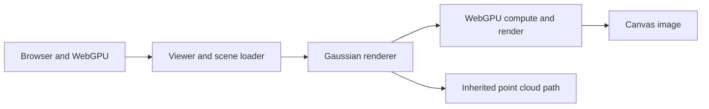
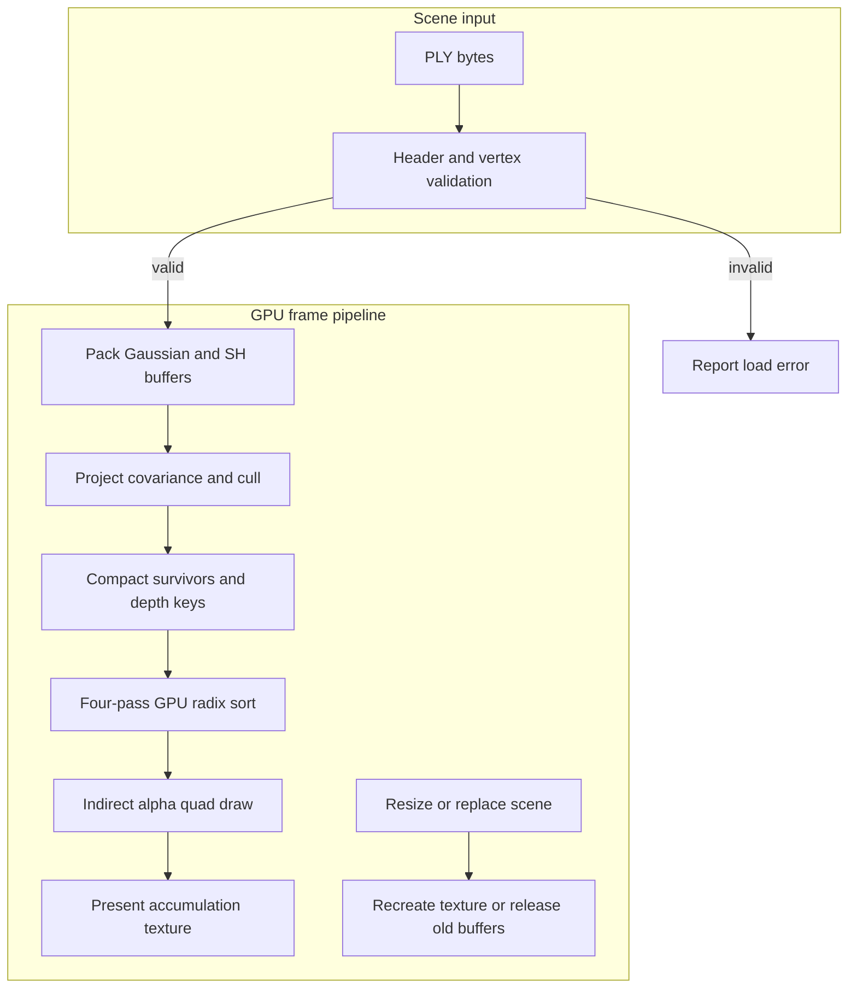

# Gaussian splat renderer

A WebGPU renderer for Gaussian PLY scenes. It projects 3D covariance into screen space, culls invisible splats, sorts survivors on the GPU and draws alpha-blended quads with view-dependent spherical-harmonic color.

Built from the complete [UPenn CIS5650 Fall 2025 starter](https://github.com/CIS5650-Fall-2025/Project5-WebGPU-Gaussian-Splat-Viewer), commit `c0b02e3a5d529b6e84528263b76533f89ab49695`. The [assignment instructions](INSTRUCTION.md), upstream history, author credits and [MIT license](LICENSE) remain. [README.upstream.md](README.upstream.md) preserves the original overview. The starter supplied the camera, loader, point-cloud path and radix sorter; this adaptation implements the Gaussian rendering path and its verification.

## Contents
- [Implementation techniques](#implementation-techniques)

- [Architecture and execution guide](#architecture-and-execution-guide)
- [Run](#run)
- [Implementation](#implementation)
- [Verification](#verification)
- [Measured procedural workloads](#measured-procedural-workloads)
- [Implementation map](IMPLEMENTATION.md)

## Implementation techniques

These cards cover the active Gaussian renderer, its inherited viewer and radix-sort path, and the diagnostic comparison path. Rationale describes the present implementation and is inferred from code; inherited techniques retain their source attribution.

| Subsystem | Techniques | Code |
| --- | --- | --- |
| PLY admission and packing | [bounded binary PLY validation](#technique-p16-binary-ply-admission), [half-precision buffer packing](#technique-p16-half-buffer-packing), [SH coefficient reordering](#technique-p16-sh-coefficient-layout) | [`plyreader.ts`](src/utils/plyreader.ts), [`load.ts`](src/utils/load.ts) |
| Camera projection and survivor generation | [quaternion covariance projection](#technique-p16-covariance-jacobian), [view-dependent SH evaluation](#technique-p16-view-dependent-sh), [atomic survivor compaction and GPU counters](#technique-p16-gpu-survivor-compaction) | [`preprocess.wgsl`](src/shaders/preprocess.wgsl), [`gaussian-renderer.ts`](src/renderers/gaussian-renderer.ts) |
| Survivor ordering | [four-pass radix histogram, prefix, and scatter](#technique-p16-gpu-radix-sort), [workgroup lookback prefix propagation](#technique-p16-lookback-prefix), [barrier-safe shared-memory exchange](#technique-p16-workgroup-barrier-exchange) | [`sort.ts`](src/sort/sort.ts), [`radix_sort.wgsl`](src/sort/radix_sort.wgsl) |
| Quad rendering and presentation | [indirect instanced-quad drawing](#technique-p16-indirect-draw), [conic raster thresholds and premultiplied blending](#technique-p16-alpha-compositing), [float accumulation and presentation pass](#technique-p16-float-presentation) | [`gaussian-renderer.ts`](src/renderers/gaussian-renderer.ts), [`gaussian.wgsl`](src/shaders/gaussian.wgsl), [`present.wgsl`](src/shaders/present.wgsl) |
| Camera and scene lifecycle | [shared camera uniforms and resize-owned resources](#technique-p16-camera-resource-lifecycle) | [`camera.ts`](src/camera/camera.ts), [`camera-control.ts`](src/camera/camera-control.ts), [`renderer.ts`](src/renderers/renderer.ts), [`gaussian-renderer.ts`](src/renderers/gaussian-renderer.ts) |
| Compatibility point-cloud renderer | [point-list rendering](#technique-p16-point-list-rendering) | [`point-cloud-renderer.ts`](src/renderers/point-cloud-renderer.ts), [`point_cloud.wgsl`](src/shaders/point_cloud.wgsl) |
| Diagnostic validation | [GPU readback with an independent CPU image oracle](#technique-p16-independent-image-oracle), [conditional timestamp-query profiling](#technique-p16-conditional-timestamp-query) | [`gaussian-renderer.ts`](src/renderers/gaussian-renderer.ts), [`renderer.ts`](src/renderers/renderer.ts), [`main.ts`](src/main.ts), [`check-gpu-readback.mjs`](scripts/check-gpu-readback.mjs) |

<a id="technique-p16-binary-ply-admission"></a>

<details>
<summary>Bounded binary PLY validation</summary>

**Mechanism.** `decodeHeader` requires the binary little-endian format, a first vertex element, unique scalar `float` or `uchar` vertex fields, required Gaussian properties, a bounded vertex count, and enough bytes for the computed stride. `load` validates every decoded value, quaternion magnitude, scale range, and adapter storage limits before allocating GPU buffers.

**Example.** A record stride is the sum of four bytes for each `float` field and one byte for each `uchar`; a short body is rejected before upload.

**Why here.** The renderer consumes one known packed Gaussian schema and allocates full-scene buffers.

**Tradeoffs.** ASCII, list properties, extra elements before vertices, files over 256 MiB, and more than one million vertices are rejected; streaming and schema-general import are absent.

**Code and ownership.** [`plyreader.ts`](src/utils/plyreader.ts#L1) `decodeHeader` and `readRawVertex`; [`load.ts`](src/utils/load.ts#L16) `load`. Extension.

</details>

<a id="technique-p16-half-buffer-packing"></a>

<details>
<summary>Half-precision GPU buffer packing</summary>

**Mechanism.** After validation, the loader writes position, opacity, quaternion, and log-scale values to one `Float16Array` mapped GPU buffer. It writes three color channels by up to sixteen SH coefficients into a second fixed-stride half buffer. The compute shader recovers pairs with `unpack2x16float`.

**Example.** Each Gaussian reserves twelve half values in the attribute record, while SH reserves 48 half values per point even when the selected degree uses fewer.

**Why here.** The shader reads compact fixed-stride storage and adapts scales with `exp` during projection.

**Tradeoffs.** Conversion loses precision and the fixed SH allocation includes unused slots for lower degrees; values outside the finite half range are refused.

**Code and ownership.** [`load.ts`](src/utils/load.ts#L5) `c_size_3d_gaussian` and `load`; [`preprocess.wgsl`](src/shaders/preprocess.wgsl#L59) `Gaussian` and `preprocess`. Extension; `Float16Array` conversion is dependency code.

</details>

<a id="technique-p16-sh-coefficient-layout"></a>

<details>
<summary>Spherical-harmonic coefficient reordering</summary>

**Mechanism.** PLY stores the `f_rest_*` values in channel-major properties. The loader derives degree from the number of rest properties, then builds a coefficient-major RGB order so each SH coefficient is contiguous by channel in the packed buffer. The shader indexes that interleave with `sh_coef` and evaluates only through the selected degree.

**Example.** Coefficient `i` reads `f_rest_i`, `f_rest_(n+i)`, and `f_rest_(2n+i)` for red, green, and blue.

**Why here.** The GPU shader can fetch the three color channels for a coefficient from a fixed per-splat block.

**Tradeoffs.** The input property count must describe a complete supported degree zero through three; the packed block still reserves all sixteen coefficients.

**Code and ownership.** [`load.ts`](src/utils/load.ts#L20) SH degree derivation and `shFeatureOrder`; [`preprocess.wgsl`](src/shaders/preprocess.wgsl#L79) `sh_coef`. Extension.

</details>

<a id="technique-p16-covariance-jacobian"></a>

<details>
<summary>Quaternion covariance projection with a perspective Jacobian</summary>

**Mechanism.** Preprocessing normalizes the stored (w,x,y,z) quaternion, exponentiates each log scale, forms `M = R diag(scale)`, then `M * transpose(M)`. It transforms covariance into view space and projects it with the perspective Jacobian using focal length and inverse depth. A 0.3-pixel diagonal floor stabilizes the projected covariance; inversion yields the conic, and the maximum eigenvalue gives a bounded three-sigma radius.

**Example.** `xx = dot(jx, Cv * jx) + 0.3` is one diagonal of the pixel covariance before determinant and conic calculation.

**Why here.** Each frame derives each Gaussian's screen footprint from the current camera and scale control.

**Tradeoffs.** A pixel floor changes very small projected shapes; nonfinite or nonpositive determinants and radii are rejected. The radius drives a square quad bound.

**Code and ownership.** [`preprocess.wgsl`](src/shaders/preprocess.wgsl#L121) `rotation` and `preprocess`; [`camera.ts`](src/camera/camera.ts#L29) `get_projection_matrix`. Extension.

</details>

<a id="technique-p16-view-dependent-sh"></a>

<details>
<summary>View-dependent spherical-harmonic color evaluation</summary>

**Mechanism.** The shader computes a normalized direction from the camera to the Gaussian center, reads packed RGB coefficients, and evaluates real SH basis terms conditionally for degrees one, two, and three. It adds the DC offset and clamps negative channels to zero before storing projected color.

**Example.** For degree one, the three directional terms multiply `-y`, `z`, and `-x` by the corresponding coefficient vectors.

**Why here.** A projected Gaussian can change color with view direction without changing its stored PLY coefficients.

**Tradeoffs.** Higher degree adds coefficient traffic and arithmetic. The checked fixture exercises first-order variation; full degree-two and degree-three GPU image coverage is not established by that fixture.

**Code and ownership.** [`preprocess.wgsl`](src/shaders/preprocess.wgsl#L5) basis constants, `sh_coef`, `computeColorFromSH`, and `preprocess`; extension renderer over PLY SH data.

</details>

<a id="technique-p16-gpu-survivor-compaction"></a>

<details>
<summary>Atomic survivor compaction and GPU counters</summary>

**Mechanism.** One compute invocation handles each Gaussian. It rejects invalid depth, clip range, determinant, radius, off-screen bounds, and opacity; survivors atomically increment `keys_size`, then write their complemented depth key and source index at the reserved slot. A second atomic counter increments indirect sort dispatch groups at block boundaries. The renderer resets counters before dispatch and copies the visible count into the indirect draw instance-count field.

**Example.** `slot = atomicAdd(&sort_infos.keys_size, 1u)` assigns a dense output position without a CPU round trip.

**Why here.** The GPU creates a compact visible list and its work counts as part of the frame.

**Tradeoffs.** Atomic slot order is nondeterministic and provides no depth ordering; later radix sorting is required. Counters must be reset for every frame.

**Code and ownership.** [`preprocess.wgsl`](src/shaders/preprocess.wgsl#L130) `preprocess`; [`gaussian-renderer.ts`](src/renderers/gaussian-renderer.ts#L69) `projection`. Extension.

</details>

<a id="technique-p16-gpu-radix-sort"></a>

<details>
<summary>Four-pass GPU radix histogram, prefix, and scatter</summary>

**Mechanism.** Preprocessing complements the IEEE bit pattern of positive view depth, so ascending unsigned keys visit farther splats first; the inherited sorter processes those 32-bit keys in four 8-bit digits. The sort records histogram clear/build once and prefixes the digit totals with four workgroups, then issues four alternating scatter dispatches for the digits, moving key and index pairs between ping-pong buffers. Padded storage and indirect workgroup dispatch cover a full block shape; the active survivor count remains in sort metadata.

**Example.** `sort` records histogram clear/build, four prefix workgroups, and alternating even/odd scatter dispatches.

**Why here.** The renderer needs a depth-ordered index stream and keeps sorting work on the GPU.

**Tradeoffs.** The sorter allocates two key and two payload buffers plus histogram storage sized for the scene; its cross-workgroup lookback has portability assumptions described separately.

**Code and ownership.** [`sort.ts`](src/sort/sort.ts#L258) `get_sorter` and `sort`; [`radix_sort.wgsl`](src/sort/radix_sort.wgsl#L136) `calculate_histogram`, `prefix_histogram`, and `scatter`. Inherited from the Fuchsia Vulkan radix-sort implementation, adapted to WebGPU/WGSL.

</details>

<a id="technique-p16-lookback-prefix"></a>

<details>
<summary>Workgroup lookback prefix propagation</summary>

**Mechanism.** During scatter, each workgroup publishes per-digit reduction or prefix status in the histogram buffer. A workgroup with prior partitions walks backward over those statuses, accumulating reductions until it reaches a published prefix, then uses that exclusive total to place its partition. The status bits distinguish invalid, reduction, and prefix entries.

**Example.** The `while true` loop in `scatter` repeatedly loads a previous partition status and continues until it observes a prefix.

**Why here.** This is the inherited sorter's cross-workgroup way to derive partition offsets within its scatter pass.

**Tradeoffs.** A workgroup can spin while earlier status is unavailable, relying on forward progress that WebGPU does not guarantee portably. A multi-dispatch global scan is an alternative with more dispatches and storage.

**Code and ownership.** [`radix_sort.wgsl`](src/sort/radix_sort.wgsl#L275) `scatter` and its partition status constants. Inherited.

</details>

<a id="technique-p16-workgroup-barrier-exchange"></a>

<details>
<summary>Barrier-safe workgroup shared-memory exchange</summary>

**Mechanism.** Scatter emulates subgroup peer matching through workgroup memory: lanes publish digits, synchronize, read peers to compute rank, then synchronize before the next row overwrites the shared array. Histogram accumulation similarly places barriers before leader writes and before lanes consume the next row. These barriers keep reads and writes uniform across lanes.

**Example.** In `scatter`, `workgroupBarrier()` follows each digit publication and peer-rank read phase.

**Why here.** The inherited algorithm uses WGSL workgroup storage to coordinate local ranks and reorder key/payload rows.

**Tradeoffs.** Barriers constrain scheduling and must not be bypassed by lane-dependent control flow. They synchronize one workgroup only and do not solve the separate cross-workgroup lookback progress assumption.

**Code and ownership.** [`radix_sort.wgsl`](src/sort/radix_sort.wgsl#L294) `scatter`, including shared-memory peer matching and histogram phases. Inherited algorithm with local synchronization repair.

</details>

<a id="technique-p16-indirect-draw"></a>

<details>
<summary>Indirect instanced-quad drawing</summary>

**Mechanism.** The render pipeline issues a six-vertex triangle-list draw indirectly. `vertex_index` selects one of six quad corners and `instance_index` selects a sorted Gaussian index. Each vertex expands the projected center by its screen-space radius; the GPU-written instance count limits instances to the compacted survivors.

**Example.** The indirect buffer starts with vertex count six; projection copies the visible count to byte offset four before `drawIndirect`.

**Why here.** One draw command expands a variable number of visible Gaussian quads without reading the count to the CPU.

**Tradeoffs.** The index stream must already be sorted and the indirect argument layout and copy offset must match the WebGPU draw command. Each Gaussian is bounded by a square, with fragment rejection trimming its footprint.

**Code and ownership.** [`gaussian-renderer.ts`](src/renderers/gaussian-renderer.ts#L75) `projection` and `draw`; [`gaussian.wgsl`](src/shaders/gaussian.wgsl#L15) `vs_main`. Extension using WebGPU indirect drawing.

</details>

<a id="technique-p16-alpha-compositing"></a>

<details>
<summary>Conic raster thresholds and premultiplied alpha blending</summary>

**Mechanism.** The fragment shader evaluates the quadratic form of the inverse conic and computes `min(0.99, opacity * exp(power))`. It discards samples outside the Gaussian (`power > 0`) or below alpha `1/255`, then emits premultiplied color. The render pipeline uses `one` and `one-minus-src-alpha` for color and alpha; sorted instances blend far to near without depth writes.

**Example.** `vec4(color * alpha, alpha)` is blended over the existing accumulation value.

**Why here.** The conic limits visible contribution inside the quad and ordered alpha blending combines overlapping splats.

**Tradeoffs.** The alpha cutoff and 0.99 cap alter tails and peak opacity. Incorrect sort order changes overlap results; a square quad still invokes fragments outside the conic support before discard.

**Code and ownership.** [`gaussian.wgsl`](src/shaders/gaussian.wgsl#L15) `vs_main` and [`gaussian.wgsl`](src/shaders/gaussian.wgsl#L26) `fs_main`; [`gaussian-renderer.ts`](src/renderers/gaussian-renderer.ts#L40) blend state. Extension.

</details>

<a id="technique-p16-float-presentation"></a>

<details>
<summary>Float accumulation followed by presentation</summary>

**Mechanism.** The renderer allocates a viewport-sized `rgba16float` texture, clears and blends the Gaussian draw into it, then draws a full-screen triangle whose fragment shader loads that texture into the configured canvas format. Resize destroys and recreates the texture only when dimensions change; the presentation bind group is rebuilt for the new view.

**Example.** `renderFrame` records projection, sorting, draw, and presentation in order.

**Why here.** Blending occurs in a float target before one final conversion to the browser canvas format.

**Tradeoffs.** The attachment consumes eight logical bytes per pixel and adds a pass. Allocation accounting includes its dimensions; logical allocation is not a physical peak-memory measurement.

**Code and ownership.** [`gaussian-renderer.ts`](src/renderers/gaussian-renderer.ts#L49) `resize` and `renderFrame`; [`present.wgsl`](src/shaders/present.wgsl#L1) `vs_main` and `fs_main`. Extension.

</details>

<a id="technique-p16-camera-resource-lifecycle"></a>

<details>
<summary>Shared camera uniforms and scene resource lifecycle</summary>

**Mechanism.** `Camera` writes view, inverse view, projection, inverse projection, viewport, and focal length into one uniform buffer shared by the selected renderers. `CameraControl` maps pointer deltas to rotation or pan and wheel movement to travel along the camera look vector, then updates that buffer. Canvas resize updates those uniforms and the Gaussian renderer replaces its sized accumulation texture. Scene installation constructs replacement renderers under a validation error scope; only after success does it destroy the prior renderer and input buffers. Renderer destruction releases sorter, projection, indirect, readback, and accumulation buffers or textures.

**Example.** `install` calls `nextGaussian.resize`, checks the validation scope, then destroys old scene-owned resources.

**Why here.** Camera and target dimensions change independently of scene data, while scene replacement must preserve the existing scene on validation failure.

**Tradeoffs.** The float target is viewport-sized and replacement briefly keeps old and new scene allocations alive during setup.

**Code and ownership.** [`camera.ts`](src/camera/camera.ts#L109) `create_camera_uniform_buffer` and `Camera`; [`camera-control.ts`](src/camera/camera-control.ts#L4) `CameraControl`; [`renderer.ts`](src/renderers/renderer.ts#L289) `install` and [`renderer.ts`](src/renderers/renderer.ts#L322) `frame`; [`gaussian-renderer.ts`](src/renderers/gaussian-renderer.ts#L53) `resize` and `destroy`. Extension over shared viewer camera/input code.

</details>

<a id="technique-p16-conditional-timestamp-query"></a>

<details>
<summary>Conditional timestamp-query profiling</summary>

**Mechanism.** Startup requests `timestamp-query` only when the adapter advertises it. The benchmark records four GPU timestamps around projection, sorting, and draw/presentation, resolves them to a buffer, and separately measures browser wall time through queue completion. If the feature is unavailable, GPU stage durations stay null while wall timing remains available.

**Example.** `querySet` writes the start and end indices at each pass boundary; benchmark code reports the resulting intervals in milliseconds.

**Why here.** The benchmark can report GPU elapsed stages where supported while retaining a host-observed frame measurement.

**Tradeoffs.** Timestamp queries are optional and their intervals are not hardware performance counters. The CPU-sort control includes readback and upload, so wall comparisons alone do not isolate sort cost or establish a CPU-sort benefit.

**Code and ownership.** [`main.ts`](src/main.ts#L21) `requestDevice`; [`renderer.ts`](src/renderers/renderer.ts#L168) benchmark query setup and #L204 timestamp conversion. Extension using optional WebGPU timestamps.

</details>

<a id="technique-p16-point-list-rendering"></a>

<details>
<summary>Point-list compatibility rendering</summary>

**Mechanism.** The selectable compatibility renderer binds the shared camera uniform and Gaussian position buffer, clears the canvas render target, and issues one point-list draw with one vertex per input point. Its shader transforms each point through the camera and emits fixed opaque yellow.

**Example.** `render` calls `pass.draw(pc.num_points)` rather than generating projected quads or sorting instances.

**Why here.** The viewer preserves the original point-cloud mode alongside the Gaussian renderer for direct mode selection.

**Tradeoffs.** This path does not apply Gaussian covariance, opacity compositing, visibility compaction, or depth sorting; it serves as a simple point view.

**Code and ownership.** [`point-cloud-renderer.ts`](src/renderers/point-cloud-renderer.ts#L5) `get_renderer` and `render`; [`point_cloud.wgsl`](src/shaders/point_cloud.wgsl#L27) `vs_main` and `fs_main`. Inherited viewer path.

</details>

<a id="technique-p16-independent-image-oracle"></a>

<details>
<summary>GPU readback with an independent CPU image oracle</summary>

**Mechanism.** Diagnostics copy survivor counts, indices, projected splat rows, depth keys, and a rendered image into map-readable buffers. A separate CPU routine computes Gaussian conic contributions and far-to-near alpha composition at selected pixels, then compares expected values to actual GPU pixels. A standalone script independently recomputes fixture conics, radius, projected center, first-order SH color, and sample error from retained diagnostics.

**Example.** The readback validates every sampled RGB error against the 0.012 tolerance and checks the fixture's expected four survivors and ordering.

**Why here.** It checks rendered output and projection against scalar calculations instead of treating shader compilation or counters as proof.

**Tradeoffs.** Mapping stalls the GPU/CPU path and diagnostics cap ordinary scenes at 4096 points. The small fixture and selected samples do not prove photorealistic quality or full high-degree SH coverage.

**Code and ownership.** [`gaussian-renderer.ts`](src/renderers/gaussian-renderer.ts#L81) `referenceFrame` and `readback`; [`check-gpu-readback.mjs`](scripts/check-gpu-readback.mjs#L1). Extension.

</details>

## Architecture and execution guide

This project adds the Gaussian splat path to the inherited WebGPU viewer. The camera, PLY scene plumbing, point-cloud renderer, and four-pass radix sorter come from the starter; projection, compaction, shading, and diagnostics are project additions. A [PLY scene](#ply-scene) becomes packed GPU input; [covariance projection](#covariance-projection) turns it into sorted screen-space quads. [Spherical harmonics](#spherical-harmonics) supply view-dependent color.



The browser owns input and canvas presentation. Viewer code validates a file and selects the Gaussian or inherited point-cloud renderer. The GPU executes the Gaussian path; this overview excludes the CPU diagnostic oracle.



The loader rejects unsupported or truncated binary layouts before upload. Compute preprocessing removes invisible splats and emits depth keys; sorting orders compacted indices before the draw. Scene replacement releases old scene-owned buffers, while resize replaces the accumulation texture.

| Subsystem | Responsibility and owned invariant | Source |
| --- | --- | --- |
| Viewer and camera | Selects renderer, updates camera uniforms, and coordinates scene lifetime. | [`main.ts`](src/main.ts), [`renderer.ts`](src/renderers/renderer.ts), [`camera.ts`](src/camera/camera.ts) |
| PLY input | Validates binary little-endian records, finite half-range values, and count limits before packing. | [`plyreader.ts`](src/utils/plyreader.ts), [`load.ts`](src/utils/load.ts) |
| Projection and culling | Converts 3D covariance to screen conic/radius and writes visible entries to sort storage. | [`preprocess.wgsl`](src/shaders/preprocess.wgsl) |
| Sort | Provides the inherited GPU radix passes and survivor ordering. | [`sort.ts`](src/sort/sort.ts), [`radix_sort.wgsl`](src/sort/radix_sort.wgsl) |
| Draw and presentation | Draws sorted quads with premultiplied far-to-near blending, then samples the float accumulation texture. | [`gaussian-renderer.ts`](src/renderers/gaussian-renderer.ts), [`gaussian.wgsl`](src/shaders/gaussian.wgsl), [`present.wgsl`](src/shaders/present.wgsl) |

The normal frame path is:

1. The viewer updates camera state and records projection and culling, which write the survivor count and depth keys.
2. The radix sorter orders survivor indices. The renderer copies the count into an indirect draw argument.
3. The draw shader expands each index into a quad and evaluates its conic Gaussian opacity. The presentation pass maps the accumulation texture to the canvas format.
4. If the adapter or device is unavailable, startup reports that state. If input validation fails, loading stops before GPU packing; replacing a scene destroys its prior buffers.

| Choice | Current implementation and rationale | Alternative and cost or reconsideration point |
| --- | --- | --- |
| GPU projection and sorting | Compute performs per-view projection and compaction, so ordinary frames do not read every depth to the CPU. | CPU sorting is retained as a diagnostic control; ordinary use would add readback and upload synchronization. |
| Full-buffer PLY loading | The loader enforces a 256 MiB limit and one-million-point ceiling, then packs the complete scene. | Streaming would support larger files but needs incremental ownership and sorting. |
| Indirect draw count | The GPU survivor count controls instance count without CPU readback. | A CPU-issued count needs synchronization and weakens the GPU-driven frame path. |
| Float accumulation target | `rgba16float` preserves intermediate alpha composition before final presentation. | Direct canvas blending reduces storage but changes precision and composition; reconsider with matching image checks. |
| Inherited radix lookback | The existing four-pass sorter is reused. | A portable multi-pass scan may avoid cross-workgroup forward-progress assumptions at additional dispatch and buffer cost. |

These choices describe the current implementation; rationale is inferred from code. The inherited lookback sorter retains a cross-workgroup forward-progress portability limit. GPU counter profiling is unavailable, so the recorded frame timings do not identify a hardware bottleneck.

<a id="ply-scene"></a>

<details><summary>What is a PLY scene?</summary>

A PLY scene is a point-cloud file with a header describing vertex fields. Here the loader accepts binary little-endian Gaussian records, such as position, opacity, quaternion, scale, and spherical-harmonic coefficients. ASCII PLY and files above 256 MiB are rejected.

</details>

<a id="covariance-projection"></a>

<details><summary>What is covariance projection?</summary>

Covariance describes a Gaussian's 3D spread and orientation. The preprocessing shader projects that shape through the camera Jacobian into a 2D conic and screen radius. The radius is bounded to a three-sigma footprint.

</details>

<a id="spherical-harmonics"></a>

<details><summary>What are spherical harmonics?</summary>

Spherical harmonics encode view-dependent color with coefficients evaluated against a direction. This renderer supports degrees zero through three; each degree adds coefficients and shader work.

</details>

<a id="radix-sort"></a>

<details><summary>What is radix sorting?</summary>

Radix sorting orders integer keys by processing digit groups. The inherited sorter orders complemented depth keys on the GPU so the draw visits visible splats far to near. Its lookback coordination has a portability limit across workgroups.

</details>

<a id="indirect-draw"></a>

<details><summary>What is an indirect draw?</summary>

An indirect draw reads vertex and instance counts from a GPU buffer. Here compute writes the visible-splat count into that buffer, avoiding CPU readback each frame.

</details>

<a id="premultiplied-alpha"></a>

<details><summary>What is premultiplied alpha?</summary>

Premultiplied alpha stores color already multiplied by opacity. The quad pass uses it with far-to-near blending so overlapping Gaussian contributions compose in the accumulation texture.

</details>

<a id="run"></a>

## Run

Use Node.js 25.8 or later for the native TypeScript checks and a WebGPU-capable browser.

```sh
npm ci
npm run check
npm run build
node node_modules/vite/bin/vite.js --host 127.0.0.1 --port 5186 --strictPort
```

Open `http://127.0.0.1:5186/`, select **Load synthetic scene**, then **GPU diagnostics**. The owned six-point fixture includes rotated and anisotropic splats, overlapping colors, an offscreen splat and one behind the camera. Four splats survive. The expected far-to-near order is `2, 0/1, 3`. All diagnostic checks should be true.

Drag the canvas to rotate, right-drag to pan, and use the wheel to move. The multiplier changes Gaussian scale. The file controls accept a Gaussian PLY and an optional camera JSON. The renderer switch retains the upstream point-cloud view.

## Implementation

- Normalized PLY quaternions and exponentiated scale produce 3D covariance. A perspective Jacobian projects it to a 2D covariance, inverse conic and three-sigma screen radius.
- Compute preprocessing rejects near/far, low-opacity and offscreen splats, compacts survivors and creates complemented depth keys. The inherited four-pass radix sorter runs on the GPU; an indirect draw consumes its survivor count.
- Sorted quads evaluate conic Gaussian opacity. Premultiplied far-to-near blending produces the final image. Spherical harmonics support degrees zero through three.
- The loader validates binary little-endian PLY layout, finite half-representable values, quaternion length, SH properties and adapter buffer limits. Scene limits are 256 MiB and one million points; this is a full-buffer loader.
- Scene replacement releases owned GPU buffers. Readback diagnostics use the actual render path, copy an offscreen GPU image and compare sampled colors with an independent CPU blending reference.

[IMPLEMENTATION.md](IMPLEMENTATION.md) maps the changed files and remaining limits. Source fixtures are maintained under `src/utils/synthetic.ts` and `public/fixtures/`.

## Verification

```sh
npm run check
npm run build
npm audit
node scripts/check-gpu-readback.mjs path/to/diagnostics.txt
```

The [verification skill](.agents/skills/verify-splatforge/SKILL.md) describes the actual browser journey. CPU checks cover parser boundaries, owned fixture values and reference math. A build alone does not establish shader execution.

Actual CUA browser checks ran the WebGPU pipeline on the owned scene. GPU readback found four survivors in the expected order. All seven diagnostics passed, including alpha composition and first-order view-dependent color. An independent scalar oracle measured conic relative error `8.43e-8`, expected and actual radius `278`, and maximum sampled RGB error `0.00342` against a tolerance of `0.012`. The scale control also changed the visible lobe sizes.

The six-point fixture was re-driven after the floating-point accumulation fix and again passed all seven checks. The historical numbers above identify the original fixture observation. Photorealistic scenes, full degree-two/three SH numerical coverage and the final narrow-screen layout remain unverified. No live deployment is configured. Hosted CI builds and runs CPU checks; it does not claim browser GPU coverage.

## Measured procedural workloads

Two complete CUA-driven campaigns on the browser-reported Intel Xe-LPG adapter (Chrome 155, Windows) completed 3,360 timed frames across six workload cells each. Each arm has seven alternating twenty-frame repetitions per cell after ten warm frames. Both campaigns passed unchanged composition and image gates in every cell; maximum CPU/GPU image error was one code against the three-code limit. All raw samples, source hashes and the [measurement contract and diagnosed fix](docs/benchmark-results-20261022.md) are retained.

Values separated by `/` are the two campaigns, in milliseconds; per-frame empirical percentiles are not confidence intervals.

| Gaussians | Viewport | GPU-path wall p50, ms | GPU-path wall p95, ms | CPU-sort roundtrip wall p50, ms |
| ---: | --- | --- | --- | --- |
| 16,384 | 640x360 | 5.90 / 5.90 | 6.90 / 6.90 | 6.00 / 6.00 |
| 16,384 | 1280x720 | 6.90 / 6.90 | 8.90 / 9.10 | 8.00 / 8.00 |
| 131,072 | 640x360 | 14.00 / 14.80 | 16.10 / 16.90 | 14.40 / 14.50 |
| 131,072 | 1280x720 | 16.90 / 16.90 | 19.30 / 20.20 | 17.50 / 17.00 |
| 524,288 | 640x360 | 44.70 / 44.80 | 59.10 / 67.60 | 46.80 / 46.40 |
| 524,288 | 1280x720 | 47.30 / 47.80 | 55.20 / 60.30 | 49.40 / 50.10 |

The GPU arm includes projection, radix sort, RGBA16-float blending and final presentation. The CPU control includes the same projection/rendering plus readback, native stable typed-array sorting and upload. Wall timing ends at queue completion. At 524,288 / 1280x720, native GPU-span p50 was 44.499 / 44.696 ms. Timing ranges overlap; no general sort speedup or display FPS claim follows. Logical allocations include the new eight-byte-per-pixel attachment and are not physical peak VRAM. These results do not meet or establish the separate 650K/1080p/72-FPS resume target. The inherited cross-workgroup radix lookback still has a forward-progress portability limit.
