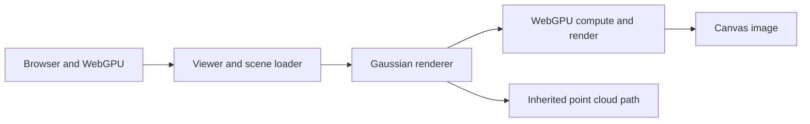
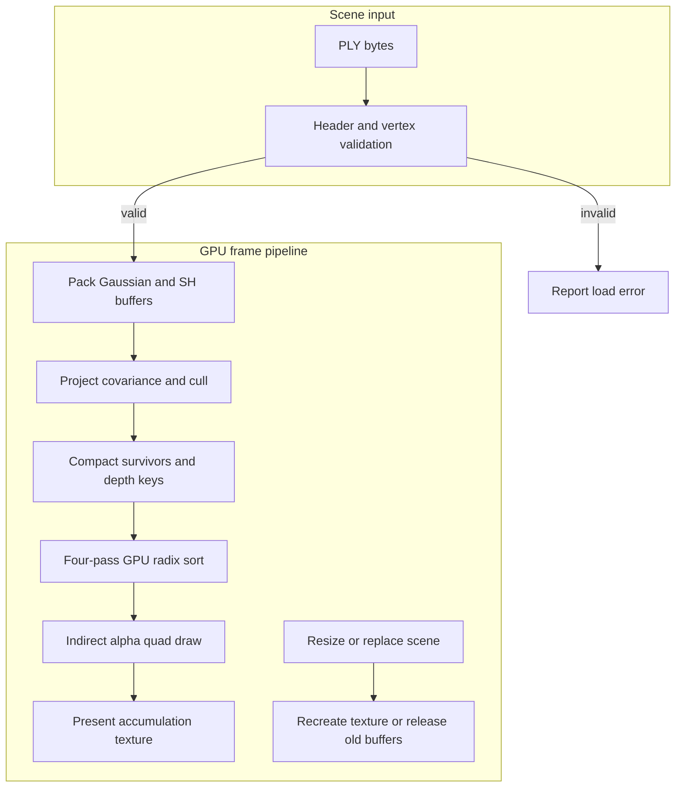

# Gaussian splat renderer

A WebGPU renderer for Gaussian PLY scenes. It projects 3D covariance into screen space, culls invisible splats, sorts survivors on the GPU and draws alpha-blended quads with view-dependent spherical-harmonic color.

Built from the complete [UPenn CIS5650 Fall 2025 starter](https://github.com/CIS5650-Fall-2025/Project5-WebGPU-Gaussian-Splat-Viewer), commit `c0b02e3a5d529b6e84528263b76533f89ab49695`. The [assignment instructions](INSTRUCTION.md), upstream history, author credits and [MIT license](LICENSE) remain. [README.upstream.md](README.upstream.md) preserves the original overview. The starter supplied the camera, loader, point-cloud path and radix sorter; this adaptation implements the Gaussian rendering path and its verification.

## Contents

- [Architecture and execution guide](#architecture-and-execution-guide)
- [Run](#run)
- [Implementation](#implementation)
- [Verification](#verification)
- [Measured procedural workloads](#measured-procedural-workloads)
- [Implementation map](IMPLEMENTATION.md)

## Architecture and execution guide

This project adds the Gaussian splat path to the inherited WebGPU viewer. The camera, PLY scene plumbing, point-cloud renderer, and four-pass radix sorter come from the starter; projection, compaction, shading, and diagnostics are project additions. A [PLY scene](#ply-scene) becomes packed GPU input; [covariance projection](#covariance-projection) turns it into sorted screen-space quads. [Spherical harmonics](#spherical-harmonics) supply view-dependent color.



The browser owns input and canvas presentation. Viewer code validates a file and selects the Gaussian or inherited point-cloud renderer. The GPU executes the Gaussian path; this overview excludes the CPU diagnostic oracle.



The loader rejects unsupported or truncated binary layouts before upload. Compute preprocessing removes invisible splats and emits depth keys; sorting orders compacted indices before the draw. Scene replacement releases old scene-owned buffers, while resize replaces the accumulation texture.

| Subsystem | Responsibility and owned invariant | Source |
| --- | --- | --- |
| Viewer and camera | Selects renderer, updates camera uniforms, and coordinates scene lifetime. | [`main.ts`](src/main.ts), [`renderer.ts`](src/renderers/renderer.ts), [`camera.ts`](src/camera/camera.ts) |
| PLY input | Validates binary little-endian records, finite half-range values, and count limits before packing. | [`plyreader.ts`](src/utils/plyreader.ts), [`load.ts`](src/utils/load.ts) |
| Projection and culling | Converts 3D covariance to screen conic/radius and writes visible entries to sort storage. | [`preprocess.wgsl`](src/shaders/preprocess.wgsl) |
| Sort | Provides the inherited GPU radix passes and survivor ordering. | [`sort.ts`](src/sort/sort.ts), [`radix_sort.wgsl`](src/sort/radix_sort.wgsl) |
| Draw and presentation | Draws sorted quads with premultiplied far-to-near blending, then samples the float accumulation texture. | [`gaussian-renderer.ts`](src/renderers/gaussian-renderer.ts), [`gaussian.wgsl`](src/shaders/gaussian.wgsl), [`present.wgsl`](src/shaders/present.wgsl) |

The normal frame path is:

1. The viewer updates camera state and records projection and culling, which write the survivor count and depth keys.
2. The radix sorter orders survivor indices. The renderer copies the count into an indirect draw argument.
3. The draw shader expands each index into a quad and evaluates its conic Gaussian opacity. The presentation pass maps the accumulation texture to the canvas format.
4. If the adapter or device is unavailable, startup reports that state. If input validation fails, loading stops before GPU packing; replacing a scene destroys its prior buffers.

| Choice | Current implementation and rationale | Alternative and cost or reconsideration point |
| --- | --- | --- |
| GPU projection and sorting | Compute performs per-view projection and compaction, so ordinary frames do not read every depth to the CPU. | CPU sorting is retained as a diagnostic control; ordinary use would add readback and upload synchronization. |
| Full-buffer PLY loading | The loader enforces a 256 MiB limit and one-million-point ceiling, then packs the complete scene. | Streaming would support larger files but needs incremental ownership and sorting. |
| Indirect draw count | The GPU survivor count controls instance count without CPU readback. | A CPU-issued count needs synchronization and weakens the GPU-driven frame path. |
| Float accumulation target | `rgba16float` preserves intermediate alpha composition before final presentation. | Direct canvas blending reduces storage but changes precision and composition; reconsider with matching image checks. |
| Inherited radix lookback | The existing four-pass sorter is reused. | A portable multi-pass scan may avoid cross-workgroup forward-progress assumptions at additional dispatch and buffer cost. |

These choices describe the current implementation; rationale is inferred from code. The inherited lookback sorter retains a cross-workgroup forward-progress portability limit. GPU counter profiling is unavailable, so the recorded frame timings do not identify a hardware bottleneck.

<a id="ply-scene"></a>

<details><summary>What is a PLY scene?</summary>

A PLY scene is a point-cloud file with a header describing vertex fields. Here the loader accepts binary little-endian Gaussian records, such as position, opacity, quaternion, scale, and spherical-harmonic coefficients. ASCII PLY and files above 256 MiB are rejected.

</details>

<a id="covariance-projection"></a>

<details><summary>What is covariance projection?</summary>

Covariance describes a Gaussian's 3D spread and orientation. The preprocessing shader projects that shape through the camera Jacobian into a 2D conic and screen radius. The radius is bounded to a three-sigma footprint.

</details>

<a id="spherical-harmonics"></a>

<details><summary>What are spherical harmonics?</summary>

Spherical harmonics encode view-dependent color with coefficients evaluated against a direction. This renderer supports degrees zero through three; each degree adds coefficients and shader work.

</details>

<a id="radix-sort"></a>

<details><summary>What is radix sorting?</summary>

Radix sorting orders integer keys by processing digit groups. The inherited sorter orders complemented depth keys on the GPU so the draw visits visible splats far to near. Its lookback coordination has a portability limit across workgroups.

</details>

<a id="indirect-draw"></a>

<details><summary>What is an indirect draw?</summary>

An indirect draw reads vertex and instance counts from a GPU buffer. Here compute writes the visible-splat count into that buffer, avoiding CPU readback each frame.

</details>

<a id="premultiplied-alpha"></a>

<details><summary>What is premultiplied alpha?</summary>

Premultiplied alpha stores color already multiplied by opacity. The quad pass uses it with far-to-near blending so overlapping Gaussian contributions compose in the accumulation texture.

</details>

<a id="run"></a>

## Run

Use Node.js 25.8 or later for the native TypeScript checks and a WebGPU-capable browser.

```sh
npm ci
npm run check
npm run build
node node_modules/vite/bin/vite.js --host 127.0.0.1 --port 5186 --strictPort
```

Open `http://127.0.0.1:5186/`, select **Load synthetic scene**, then **GPU diagnostics**. The owned six-point fixture includes rotated and anisotropic splats, overlapping colors, an offscreen splat and one behind the camera. Four splats survive. The expected far-to-near order is `2, 0/1, 3`. All diagnostic checks should be true.

Drag the canvas to rotate, right-drag to pan, and use the wheel to move. The multiplier changes Gaussian scale. The file controls accept a Gaussian PLY and an optional camera JSON. The renderer switch retains the upstream point-cloud view.

## Implementation

- Normalized PLY quaternions and exponentiated scale produce 3D covariance. A perspective Jacobian projects it to a 2D covariance, inverse conic and three-sigma screen radius.
- Compute preprocessing rejects near/far, low-opacity and offscreen splats, compacts survivors and creates complemented depth keys. The inherited four-pass radix sorter runs on the GPU; an indirect draw consumes its survivor count.
- Sorted quads evaluate conic Gaussian opacity. Premultiplied far-to-near blending produces the final image. Spherical harmonics support degrees zero through three.
- The loader validates binary little-endian PLY layout, finite half-representable values, quaternion length, SH properties and adapter buffer limits. Scene limits are 256 MiB and one million points; this is a full-buffer loader.
- Scene replacement releases owned GPU buffers. Readback diagnostics use the actual render path, copy an offscreen GPU image and compare sampled colors with an independent CPU blending reference.

[IMPLEMENTATION.md](IMPLEMENTATION.md) maps the changed files and remaining limits. Source fixtures are maintained under `src/utils/synthetic.ts` and `public/fixtures/`.

## Verification

```sh
npm run check
npm run build
npm audit
node scripts/check-gpu-readback.mjs path/to/diagnostics.txt
```

The [verification skill](.agents/skills/verify-splatforge/SKILL.md) describes the actual browser journey. CPU checks cover parser boundaries, owned fixture values and reference math. A build alone does not establish shader execution.

Actual CUA browser checks ran the WebGPU pipeline on the owned scene. GPU readback found four survivors in the expected order. All seven diagnostics passed, including alpha composition and first-order view-dependent color. An independent scalar oracle measured conic relative error `8.43e-8`, expected and actual radius `278`, and maximum sampled RGB error `0.00342` against a tolerance of `0.012`. The scale control also changed the visible lobe sizes.

The six-point fixture was re-driven after the floating-point accumulation fix and again passed all seven checks. The historical numbers above identify the original fixture observation. Photorealistic scenes, full degree-two/three SH numerical coverage and the final narrow-screen layout remain unverified. No live deployment is configured. Hosted CI builds and runs CPU checks; it does not claim browser GPU coverage.

## Measured procedural workloads

Two complete CUA-driven campaigns on the browser-reported Intel Xe-LPG adapter (Chrome 155, Windows) completed 3,360 timed frames across six workload cells each. Each arm has seven alternating twenty-frame repetitions per cell after ten warm frames. Both campaigns passed unchanged composition and image gates in every cell; maximum CPU/GPU image error was one code against the three-code limit. All raw samples, source hashes and the [measurement contract and diagnosed fix](docs/benchmark-results-20261022.md) are retained.

Values separated by `/` are the two campaigns, in milliseconds; per-frame empirical percentiles are not confidence intervals.

| Gaussians | Viewport | GPU-path wall p50, ms | GPU-path wall p95, ms | CPU-sort roundtrip wall p50, ms |
| ---: | --- | --- | --- | --- |
| 16,384 | 640x360 | 5.90 / 5.90 | 6.90 / 6.90 | 6.00 / 6.00 |
| 16,384 | 1280x720 | 6.90 / 6.90 | 8.90 / 9.10 | 8.00 / 8.00 |
| 131,072 | 640x360 | 14.00 / 14.80 | 16.10 / 16.90 | 14.40 / 14.50 |
| 131,072 | 1280x720 | 16.90 / 16.90 | 19.30 / 20.20 | 17.50 / 17.00 |
| 524,288 | 640x360 | 44.70 / 44.80 | 59.10 / 67.60 | 46.80 / 46.40 |
| 524,288 | 1280x720 | 47.30 / 47.80 | 55.20 / 60.30 | 49.40 / 50.10 |

The GPU arm includes projection, radix sort, RGBA16-float blending and final presentation. The CPU control includes the same projection/rendering plus readback, native stable typed-array sorting and upload. Wall timing ends at queue completion. At 524,288 / 1280x720, native GPU-span p50 was 44.499 / 44.696 ms. Timing ranges overlap; no general sort speedup or display FPS claim follows. Logical allocations include the new eight-byte-per-pixel attachment and are not physical peak VRAM. These results do not meet or establish the separate 650K/1080p/72-FPS resume target. The inherited cross-workgroup radix lookback still has a forward-progress portability limit.
